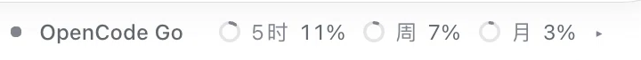

# dsh-opencode-go-strip

An [OpenCode Go](https://opencode.ai/go) quota meter for **DeepSeek Harness (DSH)**:
a compact strip under the composer, and a popover with per-window rings.

> Unofficial. Not affiliated with DeepSeek or with OpenCode.

## What it shows



- **Strip** (below the composer, always visible while a session is open): the OpenCode
  mark, the `OpenCode Go` label, and one ring per plan window with its used percentage.
  Hovering a window shows its used/remaining split and reset countdown in place.
- **Popover** (click the strip): the title, one row per window with a ring, the used
  percentage and the reset countdown, plus the API-key controls and a picker for
  saved keys. Click outside or press <kbd>Esc</kbd> to close.
- Rings follow the host's own quota meter: a faint track is what is left, the arc is
  what is used, and the arc turns amber/red at 70%/90%.

The three windows come from the OpenCode Go plan: rolling 5-hour, weekly, monthly.

## Requirements

- DeepSeek Harness with the Web UI (Desktop app or `dsh web`).
- An OpenCode Go (or Go Plus) subscription.
- Tested against DSH `0.2.2-rc.2`. The plugin only uses documented extension points
  (`conversation.composer.dock`, `webServer.register`, `connection.admit`,
  `credentials`), but DSH moves fast — an incompatibility shows up as the strip
  failing to appear, not as a crash.

## Install

The repository is a complete DSH bundle: no dependencies, no build step.

**From the plugin market** — install the experimental plugin-market bundle once,
then add this index URL in its **Discover** tab:

```
https://raw.githubusercontent.com/kzhw615/dsh-opencode-go-strip/main/plugin-index.json
```

**From GitHub, without cloning** — **Settings › Plugins › Add plugin**, paste either
address:

```
github:kzhw615/dsh-opencode-go-strip
https://github.com/kzhw615/dsh-opencode-go-strip
```

**From a checkout** — clone the repository, then **Settings › Plugins › Add plugin**
and choose the directory.

Every route ends the same way: the bundle enables itself and the strip appears the
next time a session is open. To pick up later commits, remove the bundle and add it
again; an unchanged address is reported as already installed.

`package.json` declares `engines.dsh: ">=0.2.2-rc.2"`, so an older Harness refuses
the install instead of accepting a bundle whose slot never registers.

## Updates

The popover shows the running version beside the update stamp. When the published
index names a newer one, an **Update** button appears next to it: pressing it asks
DSH's plugin manager to replace the bundle with the commit that index pins, which
is the same atomic remove-and-install the plugin panel performs, and the strip
reloads with the new code.

That works for a bundle installed from Git or from the plugin market. A copy
installed from a local folder is your own checkout — the plugin reports
`not-git` and leaves it alone; update the checkout instead.

The version check reads this repository's `plugin-index.json` from
`raw.githubusercontent.com`, cached for ten minutes by the Host and polled on the
same slow cadence from the page. It carries no credential.

## Releasing

The bundle ships from this repository only. `package.json` is `private`, so a stray
`npm publish` cannot push it out, while installing from git keeps working.

```sh
npm run release minor     # or patch / major; --dry-run prints the plan
```

That bumps the version, runs the tests, commits, regenerates `plugin-index.json`
pinned to that commit, commits the index, tags, and pushes — in that order,
because the index must point at a commit that already carries the new version.
`test/index.test.mjs` fails when the index disagrees with `package.json`, so a
forgotten regeneration cannot be pushed.

## Configure the key

The key never has to be typed into a config file. Resolution order, first hit wins:

1. The **active saved key** — the one selected in the popover, stored in the credential
   record `opencode-go-usage/keys`. Tick **This session only (not written to disk)** to
   keep a key in the Host process memory instead; it then disappears when the plugin
   unloads or DSH restarts, and it is offered in the picker as *This session*.
2. `OPENCODE_GO_API_KEY`, then `OPENCODE_ZEN_GO_API_KEY`, then `OPENCODE_API_KEY`.
3. The local OpenCode `auth.json` — `$XDG_DATA_HOME/opencode/auth.json`, its
   `~/.local/share/opencode/auth.json` default, or `~/.config/opencode/auth.json` —
   reading the `opencode-go` entry. `OPENCODE_AUTH_CONTENT`, when set, is read instead
   of a file.

### Several keys

Save more than one key with an optional label and switch between them from the picker
next to the mask. Only one account is queried at a time, because the endpoint reports a
single account's windows and deliberately does not combine keys.

Removing a key takes two presses: hover a row in the picker and press `×` (it turns into
*Delete?*), or select the key and use **Clear** in the footer — both remove only that one
key, and the first remaining key becomes active. A key saved by an earlier single-key
version of this plugin is adopted automatically and left in place on disk.

With no key anywhere, the strip reads *No API key · click to set* and the popover
opens the input form directly.

## Security notes

- The key stays on the Host. The browser half calls a package-private route and only
  ever receives a mask (`abcd…wxyz`).
- Saved keys land in DSH's credential store (`~/.dsh/.credentials.yaml`, mode `0600`
  inside a `0700` directory). That store is **plaintext YAML** and adds no encryption;
  the same file already holds your other provider keys. Use the session-only option,
  or an environment variable, if you do not want it on disk.
- Nothing here logs the key, and the plugin registers no agent tool and writes no
  session event, so the key never reaches a model request or transcript.
- The key is sent to exactly one host: `GET https://opencode.ai/zen/go/v1/usage`
  with an `Authorization: Bearer` header.
- One more request leaves the machine, without any credential: the update check
  reads this repository's `plugin-index.json` from `raw.githubusercontent.com`
  once on start and then about every ten minutes (the Host caches it for ten
  minutes). It only ever reads a version and a commit SHA.
- Revoke by rotating the key in the OpenCode console, or **Clear** it in the popover.

## Data and refresh behaviour

The endpoint returns **percentages only** (`percent`, `status`, `resetsAt` per window),
so no dollar amounts or per-model balances are derived, and several keys are not
summed. Successful responses are cached for 60 s and failures for 15 s; the strip polls
about once a minute while the page is visible, and **Refresh** is not throttled. A failed
refresh keeps the last good numbers on screen with a *last refresh failed* note, and a
window the endpoint does not report shows *Not reported* instead of disappearing.

## Development

No build step, no dependencies, no bundler. The test suite runs on plain Node and
stubs both the Host context and React, so it works offline:

```sh
npm test        # guards + host route + rendered component
npm run check    # node --check on both halves
```

`test/guards.test.mjs` asserts the invariants that are easy to break by hand: every
class the component renders has a base style rule, the stylesheet only uses host
tokens, the plugin never logs or returns the key, and exactly one outbound endpoint
exists. `test/host.test.mjs` drives the real HTTP handler with a stubbed `fetch`.
`test/client.test.mjs` renders the strip and popover with a small React shim.

## Notes for maintainers

- The plugin mounts its own admitted HTTP route (`/opencode-go-usage`) instead of
  `connection.rpc.handle()`. In DSH `0.2.2-rc.2` that helper resolves `webServer`
  against the connection service's own context, which does not inject it, so the call
  throws `cannot get property "webServer" without inject` for any outside plugin.
- Styling uses the host's theme and type tokens only (`--dsw-alias-*`, `--dsw-font-*`,
  `--dsw-radius-*`), with fallbacks, so a renamed token degrades appearance but never
  breaks rendering.
- `client.js` is plain browser JavaScript loaded through DSH's module loader; there is
  no build step, no bundler and no runtime dependency besides React (and `react-dom`
  for the popover portal, with an inline fallback if a carrier omits it).

## License

MIT — see [LICENSE](LICENSE).

---

## 中文说明

DSH（DeepSeek Harness）的 OpenCode Go 额度插件：输入框下方一条细条，点击弹出浮层。

- **细条**：OpenCode 图标 + `OpenCode Go` + 三个窗口的圆环与已用百分比。
- **浮层**：每个窗口一行（圆环、已用百分比、重置倒计时）+ Key 管理。点空白处或 <kbd>Esc</kbd> 关闭。
- **圆环**：浅灰轨道是剩余，深灰弧是已用；到 70%/90% 变黄/变红。

### 安装

本仓库本身就是一个完整 bundle（无依赖、无构建步骤）。

**从插件市场装** —— 先装一次官方的实验性插件市场 bundle，然后在其 **Discover** 页添加本索
引地址：

```
https://raw.githubusercontent.com/kzhw615/dsh-opencode-go-strip/main/plugin-index.json
```

**从 GitHub 装（不用 clone）** —— **设置 › 插件 › 添加插件**，粘贴下面任一地址：

```
github:kzhw615/dsh-opencode-go-strip
https://github.com/kzhw615/dsh-opencode-go-strip
```

**已经 clone 了** —— **设置 › 插件 › 添加插件**，选择该目录。

四条路殊途同归：bundle 会自动启用，打开会话就能看到细条。想更新到新提交，移除后重新添
加即可（地址没变时会被判定为「已安装」）。

`package.json` 声明了 `engines.dsh: ">=0.2.2-rc.2"`，更老的 DSH 会直接拒绝安装，而不是
装上去却看不到细条。

### 配置 Key

优先级：本插件保存的凭证记录 → `OPENCODE_GO_API_KEY` / `OPENCODE_ZEN_GO_API_KEY` /
`OPENCODE_API_KEY` → 本地 OpenCode 的 `auth.json`（`opencode-go` 条目）。

在浮层里粘贴 Key 即可保存；勾选「仅本次会话使用（不写入磁盘）」则只留在内存里。

### 多个 Key

可以保存多个 Key（带可选标签），在浮层的下拉里切换。一次只查询一个账号——接口只返回
单个账号的额度，且明确说明不同 Key 的额度不能相加。

删除要按两下：鼠标移到某一行按 `×`（会变成「确认？」），或先选中它再按底部的「清除」。
两种方式都只删那一个 Key，剩下的第一个会自动成为当前。旧版单 Key 记录会被自动接管，
不会删除原文件。

### 细条悬停

鼠标停在细条里某个窗口上，会在它上方显示该窗口的已用/剩余比例和重置倒计时，不用打开浮层。

### 更新

浮层右上角会显示当前版本（跟在「更新于 …」后面）。当发布索引里有更新版本时，旁边会出现
「更新 x.y.z」按钮：点一下就交给 DSH 的插件管理器，用索引里钉住的那个 commit 原子地
卸载并重装，细条随之换成新代码。

这条路对 **从 Git 或插件市场安装**的副本有效。如果你是从本地目录（link）安装的，那本来就
是你的代码仓库，插件会判定为 `not-git` 不去动它——直接更新你的 checkout 即可。

版本检查只读取本仓库的 `plugin-index.json`（`raw.githubusercontent.com`），Host 侧缓存
十分钟，页面按同样稀疏的节奏轮询，**不携带任何凭证**。

### 发版

只从本仓库分发。`package.json` 是 `private`，误敲 `npm publish` 不会发出去，而从 git
安装不受影响。

```sh
npm run release minor     # 或 patch / major；加 --dry-run 只打印计划
```

这个脚本按顺序做：升版本 → 跑测试 → 提交 → 按新 commit 重新生成 `plugin-index.json` →
提交索引 → 打 tag → 推送。顺序不能反：索引必须指向"已经带上新版本号"的那个 commit。
`test/index.test.mjs` 会在索引与 `package.json` 不一致时报错，忘记重新生成就推不出去。

### 安全

Key 只留在 Host 侧，浏览器只拿到掩码；只会发往 `https://opencode.ai/zen/go/v1/usage`。
保存时写入 DSH 凭证库（`~/.dsh/.credentials.yaml`，权限 600，**明文 YAML**，与你其他
provider key 同一个文件）。插件不写日志、不注册 agent 工具、不写会话事件，Key 不会进入
对话记录或模型请求。

### 限制

接口只返回百分比，插件不推算金额；接口未列入正式文档，格式变化会显示为查询异常而不是
假装有数据。
